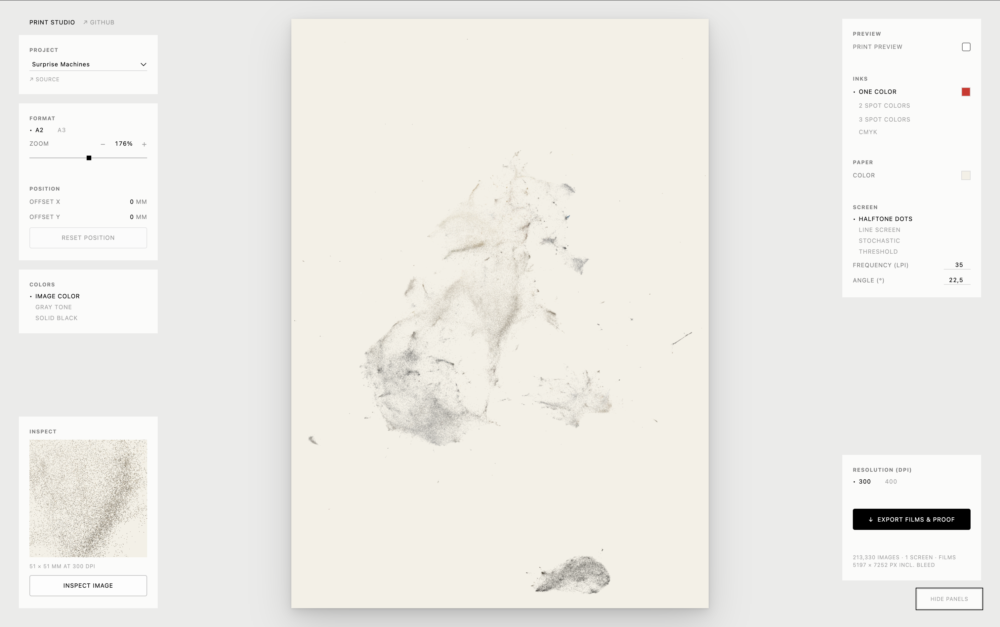
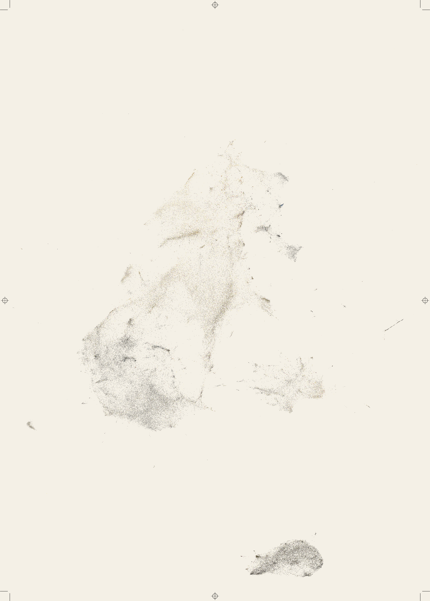
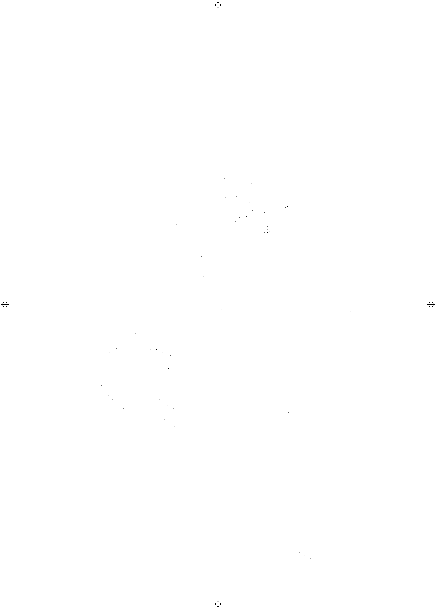
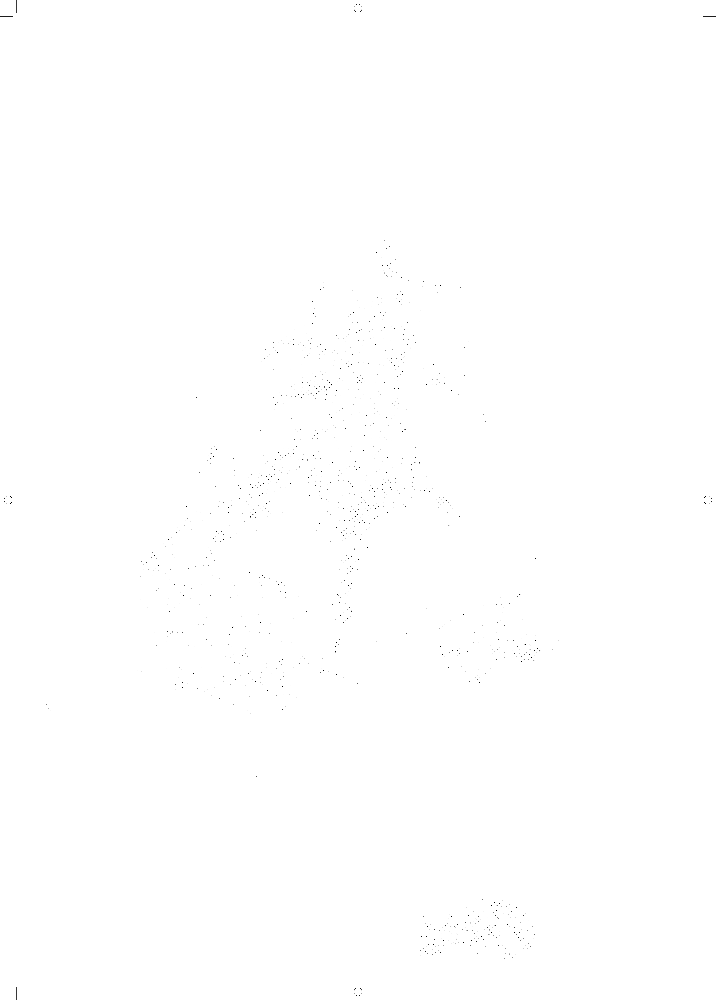
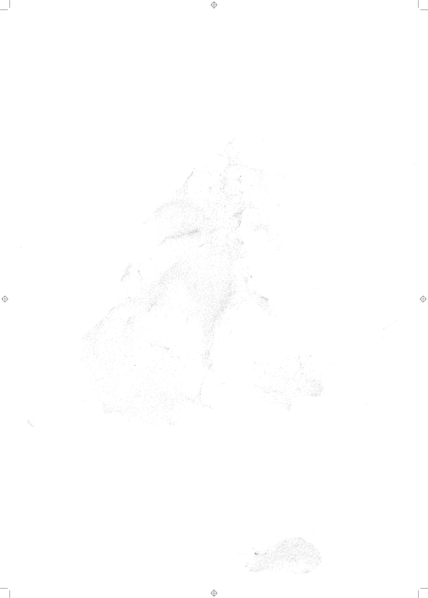
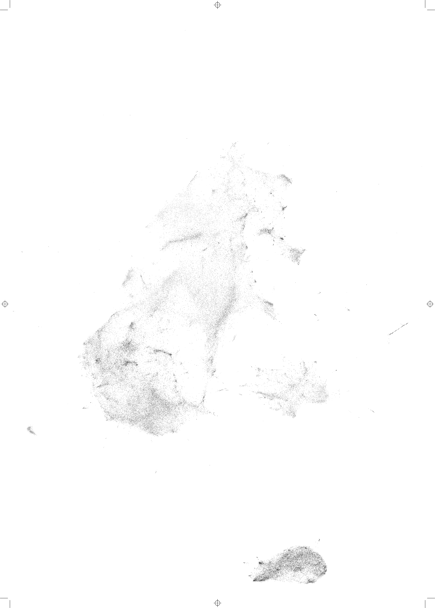

# Print Studio

[**Open Print Studio →**](https://rodighiero.github.io/print-studio/)

Print Studio turns data visualizations into films for screen printing. Compose a print sheet, choose your inks, inspect the screened detail, and export one film per ink alongside a color proof.

The first project is [*Surprise Machines*](https://github.com/rodighiero/surprise-machines): **213,330 images from the Harvard Art Museums**, arranged by visual similarity. Each artwork becomes a dot whose color comes from its source image, translating the collection into a printable landscape.



*Surprise Machines in the original image-color view, with the Inspect panel showing a selected area at export resolution.*

## Getting started

Requires **Node.js 22.12 or later** and npm.

```sh
npm install
npm run dev
```

Open [localhost:8000](http://localhost:8000/). The studio loads its collection from `data/` over HTTP; opening `index.html` directly from the filesystem will not load the data.

To create and preview a production build:

```sh
npm run build
npm run preview
```

The source repository is available at [github.com/rodighiero/print-studio](https://github.com/rodighiero/print-studio). The build includes the collection data in `dist/`, ready for static hosting. Stop the development server before running the preview server; both use port 8000.

The [live studio](https://rodighiero.github.io/print-studio/) is hosted on GitHub Pages. Pushes to `main` run the tests, build the studio with its collection data, and deploy it through [GitHub Actions](.github/workflows/pages.yml).

## Compose a print

Choose a project, then set the sheet to **A2 (420 × 594 mm)** or **A3 (297 × 420 mm)**. Both formats are portrait. Drag the image to position it, and use the slider or scroll to zoom between 100% and 250%. The **+** and **−** buttons change zoom by 10 percentage points. **Reset position** returns to the original project center.

The **Colors** panel controls the source design: image color, gray tone, or solid black. The UMAP layout preserves the collection’s arrangement by visual similarity. Dots use a consistent physical area derived from the original thumbnails’ mean area; their size follows the sheet format and zoom automatically.

## Preview and inks

Enable **Print preview** to see a smooth composite proof in the selected inks. Disable it to see the original design colors. The **Films** section lets you switch between the composite and individual ink films while Print preview is enabled.

| Ink choice | Separation and screening |
| --- | --- |
| One color | Choose an ink; use halftone dots, line screen, stochastic screening, or threshold. |
| 2 spot colors | Separate into two inks using flat nearest-color matching or dithering. |
| 3 spot colors | Separate into three inks using flat nearest-color matching or dithering. |
| CMYK | Four process inks, with adjustable black generation and screening. |

The two spot palettes are generated independently from the original artwork colors. Similar hues are spread apart in [Oklab](https://bottosson.github.io/posts/oklab/) while keeping their perceived lightness and saturation consistent. Saturation is reduced where necessary to stay within the display color range. Each palette remains editable and retains its own colors when switching ink choices.

Choose the paper color separately. Color matching accounts for that paper color. Halftone dots and line screens offer frequency and angle controls; CMYK uses fixed angles of C 15°, M 75°, Y 0°, and K 45°.

## Inspect the detail

The **Inspect** panel shows a selected area at export resolution. It follows the Print preview toggle: original colors when unchecked, actual screened output when checked. The central composite is a smooth proof; Inspect reveals the film pixels.

Click **Inspect image** to replace the pointer with a square matching the inspection area. Move across the sheet to update the detail live, then click to keep an area and return to dragging. **Escape** or **Cancel inspection** restores the previous selection. Hover over the Inspect panel to highlight its selected area on the sheet.

| Control | Action |
| --- | --- |
| Drag | Move the composition. |
| Scroll | Zoom smoothly. |
| `+` / `−` | Zoom by 10 percentage points. |
| `I` on the sheet | Toggle inspection. |
| Arrow keys while inspecting | Move the inspection square; hold Shift for larger steps. |
| Enter while inspecting | Keep the selected area and return to dragging. |
| Escape | Cancel inspection. |
| `H` | Hide or show the panels. |

## Export films

Choose **300 or 400 dpi**, then click **Export films & proof**. Export produces:

- One pure black-on-white PNG film per ink.
- A color proof of the screened result on the selected paper color.
- Embedded DPI metadata so print and layout software can recover the intended physical size.

Each film extends **10 mm beyond the sheet on every side**, carrying matching registration targets and crop marks. Artwork stays clipped to the sheet. At A2 and 300 dpi, the sheet is 4961 × 7016 pixels and each film is 5197 × 7252 pixels, including the bleed.

Where the browser supports folder selection, choose a destination once for all files. Otherwise, files download individually. Export always uses the actual screened output, regardless of the Print preview toggle. Full-resolution exports run in a background worker and can use several hundred megabytes of memory.

### Example output

A CMYK export of *Surprise Machines* at 300 dpi: the composite proof on the chosen paper color, followed by the four black-on-white separation films. Registration targets and crop marks align across every film. Click an image to open the full-resolution PNG.

<p align="center">
  <a href="docs/images/output-proof.png"></a>
</p>

| Cyan (C) | Magenta (M) | Yellow (Y) | Black (K) |
| --- | --- | --- | --- |
| [](docs/images/output-cyan.png) | [](docs/images/output-magenta.png) | [](docs/images/output-yellow.png) | [](docs/images/output-black.png) |

## Settings and rendering

[`studio-settings.json`](studio-settings.json) defines the project defaults. Browser changes save automatically in local storage and return after a refresh, including composition, ink colors, paper, resolution, and the selected film. Only overrides are saved, so untouched controls follow future default changes. Settings are specific to the browser and site address; saved edits to generated palettes override their generated defaults.

Geometry is defined in sheet millimeters and shared by the preview, inspection crop, and export. Screens and dithers are anchored to absolute sheet pixels so an inspection crop matches the corresponding exported area. Subpixel dots preserve their physical coverage. Flat and dithered spot separation preserve partial mark coverage as binary film pixels, keeping faint dots visible without introducing gray into the films. Fully covered marks remain solid across all screen phases.

Preview, inspection, and export use separate workers, with a main-thread fallback if workers are unavailable.

## Development and data

Run the checks with:

```sh
npm test
```

The tests cover physical mark sizing, crop consistency, palette generation and contrast, ink separation, screening, registration marks, motion previews, PNG resolution metadata, and asynchronous export failures.

`data/` contains approximately 18 MB of PixPlot output: the manifest, image list, layout, cluster hotspots, and three image atlases. The 213,330 individual thumbnails from the original repository are not included; the studio reads artwork colors from the atlases.

| Path | Purpose |
| --- | --- |
| `index.html` | Studio interface. |
| `studio-settings.json` | Committed project defaults. |
| `assets/print/app.js` | Controls, persistence, preview, inspection, and export orchestration. |
| `assets/print/data.js` | Collection loading and source-color measurement. |
| `assets/print/render.js` | Physical sheet and mark geometry. |
| `assets/print/palette*.js` | Source-derived palettes and hue separation. |
| `assets/print/inspection.js` | Pixel-aligned inspection crops. |
| `assets/print/separate.js` | Ink separation, screening, proofs, and registration marks. |
| `assets/print/export.js` | PNG encoding, resolution metadata, and saving. |
| `assets/print/preview-worker.js` | Preview, inspection, and export worker entry point. |
| `assets/print/motion-preview.js` | Responsive composition movement while rendering. |
| `assets/print/print.css` | Interface styles and responsive layout. |
| `vite.config.js` | Development server and static build configuration. |

## Credits and citation

*Surprise Machines* was created for the exhibition *Curatorial A(i)gents* (2022) by Dario Rodighiero, Lins Derry, Douglas Duhaime, Jordan Kruguer, Maximilian C. Mueller, Christopher Pietsch, Jeffrey T. Schnapp, Jeff Steward, and metaLAB (at) Harvard.

Rodighiero, D., Derry, L., Duhaime, D., Kruguer, J., Mueller, M. C., Pietsch, C., Schnapp, J. T., Steward, J., & metaLAB. (2022). Surprise Machines: Revealing Harvard Art Museums' image collection. *Information Design Journal*, 27(1), 21–34. [doi:10.1075/idj.22013.rod](https://doi.org/10.1075/idj.22013.rod)

Collection layouts and atlases were generated with [PixPlot](https://github.com/YaleDHLab/pix-plot), developed by the Yale Digital Humanities Lab. Palette hue separation uses Björn Ottosson’s [Oklab color space](https://bottosson.github.io/posts/oklab/).

## License

Code is distributed under the [MIT License](LICENSE). Harvard Art Museums images and metadata are not covered by the code license; see the collection notice in `LICENSE`. This project presents the collection for research and educational purposes.
