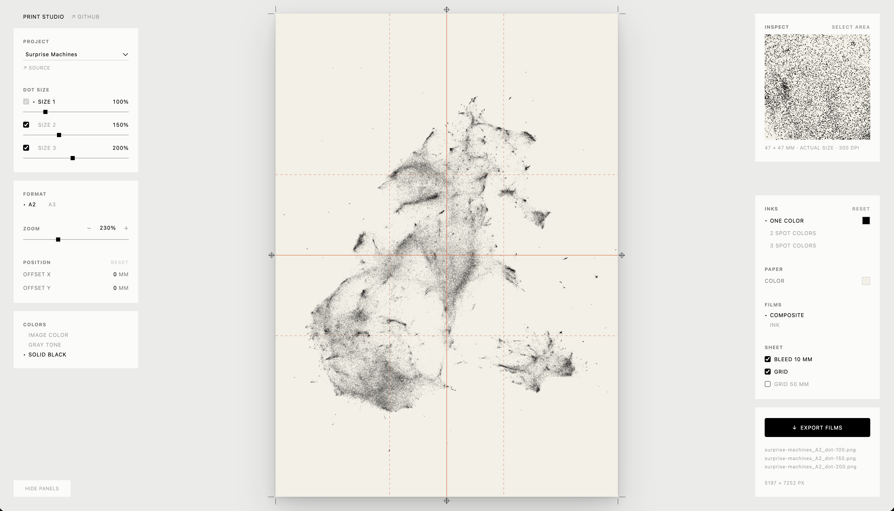

# Print Studio

[**Open Print Studio →**](https://rodighiero.github.io/print-studio/)

Print Studio turns data visualizations into screen-printing films: compose a sheet, choose inks, inspect the dots, and export one film per ink.

The first project is [*Surprise Machines*](https://github.com/rodighiero/surprise-machines): **213,330 Harvard Art Museums images** arranged by visual similarity, each drawn as a dot in its image's color.



## Getting started

Requires **Node.js 22.12+**.

```sh
npm install
npm run dev     # http://localhost:8000
npm run build   # static build with data in dist/
npm run preview # serves the build on the same port
```

Open the studio over HTTP; `index.html` from the filesystem cannot load `data/`. Pushes to `main` test, build and deploy the [live studio](https://rodighiero.github.io/print-studio/) to GitHub Pages.

## Compose

- **Project**: the visualization. **Dot size** scales dots from 25% to 400% of the original thumbnails. Size 1 always exports; check Size 2 or 3 for extra film sets. The bulleted size is previewed.
- **Format**: A2 or A3, portrait. **Zoom**: 100–500% by slider, scroll or **+**/**−**.
- **Position**: drag the sheet to move the image; **Reset** recenters it on the image's main body (the small detached cluster is left out of the centering).
- **Colors**: image color, gray tone or solid black.

## Inks

The sheet shows the print in the chosen inks on the paper color, at 60 dpi (tone, not dots).

- **One color**: one ink with a stochastic (FM) screen, which keeps the tiny marks intact.
- **2 or 3 spot colors**: palettes generated from the artwork colors, separated flat or dithered. **Reset** restores the generated palettes.
- **Paper**: the sheet color, used in the preview and in spot separation.
- **Films**: preview the composite or one ink's film.
- **Sheet**: **Bleed 10 mm** adds a band with registration and crop marks (shown around the sheet); **Grid** shows center and thirds, **Grid 50 mm** thin lines every 50 mm. Grids never print.

## Inspect

**Inspect** shows the selected film at 300 dpi and about actual size (96 CSS px per inch; many laptops show it slightly smaller). Click **Select area**, move the square over the sheet, and click to keep an area; **Cancel** or Escape restores the previous one. Hover the panel to highlight its area on the sheet.

| Key | Action |
| --- | --- |
| Drag / scroll | Move / zoom |
| `+` / `−` | Zoom by 10 points |
| `I` | Inspect; arrows move the square (Shift for larger steps), Enter keeps it, Escape cancels |
| `G` / `H` | Toggle center and thirds grid / panels |

## Export

**Export films** writes one black-on-white PNG per ink at **300 dpi** for each dot size, with the resolution embedded. An A2 film is 4961 × 7016 px, or 5197 × 7252 px with bleed. File names are listed below the button:

| Setup | Example |
| --- | --- |
| One color | `surprise-machines_A2.png` |
| Several dot sizes | `surprise-machines_A2_dot-150.png` |
| Spot colors | `surprise-machines_A2_3inks_ink-1-e4572e.png` |

Choose a folder once where the browser allows it; otherwise files download one by one.

## How it works

- Defaults live in [`studio-settings.json`](studio-settings.json); changes, the inspected area and hidden panels are saved in the browser.
- Geometry is in sheet millimeters and screens are anchored to sheet pixels, so preview, Inspect and export match exactly.
- Preview, Inspect and export run in workers, falling back to the main thread.
- `npm test` covers loading, dot sizing, centering, crops, palettes, separation, marks, PNG export and file names.
- `data/` holds about 18 MB of PixPlot output (manifest, image list, layout, hotspots, atlases); colors come from the atlases, not the 213,330 thumbnails.

### Files

| Path | Purpose |
| --- | --- |
| `index.html` | Studio interface. |
| `studio-settings.json` | Committed project defaults. |
| `assets/print/app.js` | Controls, persistence, preview, inspection, and export orchestration. |
| `assets/print/data.js` | Collection loading and source-color measurement. |
| `assets/print/render.js` | Physical sheet and mark geometry, and image centering. |
| `assets/print/palette*.js` | Source-derived palettes and hue separation. |
| `assets/print/inspection.js` | Pixel-aligned inspection crops. |
| `assets/print/separate.js` | Ink separation, screening, composite preview, and registration marks. |
| `assets/print/export.js` | PNG encoding, file names, resolution metadata, and saving. |
| `assets/print/preview-worker.js` | Preview, inspection, and export worker entry point. |
| `assets/print/motion-preview.js` | Responsive composition movement while rendering. |
| `assets/print/print.css` | Interface styles and responsive layout. |
| `vite.config.js` | Development server and static build configuration. |

## Credits and citation

*Surprise Machines* was created for the exhibition *Curatorial A(i)gents* (2022) by Dario Rodighiero, Lins Derry, Douglas Duhaime, Jordan Kruguer, Maximilian C. Mueller, Christopher Pietsch, Jeffrey Schnapp, Jeff Steward, and metaLAB (at) Harvard.

Rodighiero, D., Derry, L., Duhaime, D., Kruguer, J., Mueller, M. C., Pietsch, C., Schnapp, J. T., Steward, J., & metaLAB. (2022). Surprise Machines: Revealing Harvard Art Museums' image collection. *Information Design Journal*, 27(1), 21–34. [doi:10.1075/idj.22013.rod](https://doi.org/10.1075/idj.22013.rod)

Collection layouts and atlases were generated with [PixPlot](https://github.com/YaleDHLab/pix-plot), developed by the Yale Digital Humanities Lab. Palette hue separation uses Björn Ottosson’s [Oklab color space](https://bottosson.github.io/posts/oklab/).

## License

Code is distributed under the [MIT License](LICENSE). Harvard Art Museums images and metadata are not covered by the code license; see the collection notice in `LICENSE`. This project presents the collection for research and educational purposes.
